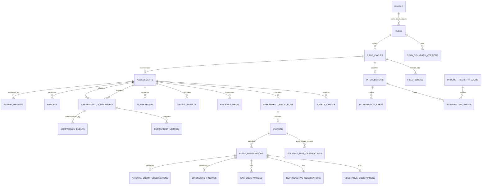

# WormWise Database and Data Model v1

## 1. Status and scope

- Status: implementation-ready draft derived from `ASSESSMENT_PROTOCOL.md`
- Crop scope: maize/corn only
- Database scope: offline field collection, evidence, calculations, intervention history, follow-up comparisons, review, reporting, and synchronization
- Architecture status: this is a data model, not a claim that the thesis system architecture is final
- Source of truth: raw field observations and their provenance; calculated metrics are reproducible snapshots

This model replaces the current demo-only in-memory values with a normalized relational structure. The current Flutter project has no persistence dependency. SQLite is recommended for the phone database because the data is relational, must work offline, needs transactions and migrations, and requires reliable aggregate queries. Drift is the recommended Flutter mapping layer when implementation begins, but the logical model is not tied to Drift.

## 2. Core modelling rules

1. Use UUID text identifiers generated on the phone so records can be created offline.
2. Store timestamps in UTC ISO-8601 text and store the local time-zone offset used at capture.
3. Never overwrite raw evaluator observations with AI or expert results.
4. Keep raw observations, calculated metrics, AI suggestions, evaluator decisions, and expert validation separate.
5. Keep exact, estimated, reported, OCR-extracted, evaluator-confirmed, registry-verified, and expert-confirmed values distinguishable.
6. Keep stage-specific metrics separate. Vegetative, VT-R2, and R3-R6 results are not interchangeable.
7. Keep confirmed FAW, FAW-consistent-unconfirmed, other pest, non-pest, mixed, and uncertain diagnoses separate.
8. Keep naturally observed enemies separate from intentionally released or applied biological-control agents.
9. Keep intervention history separate from follow-up interpretation.
10. A before-and-after field comparison stores observed change, not experimental product efficacy.
11. Soft-delete synchronized records using `deleted_at`; do not destroy audit history.
12. Version field boundaries, protocols, formulas, reports, registry lookups, and AI models.

## 3. Entity relationship overview



## 4. Main entity groups

### 4.1 Identity and ownership

#### `people`

Stores farmers/owners, evaluators, applicators, advisers, and reviewers. One person can appear in multiple roles through records that reference them.

Important fields:

- `id`
- `display_name`
- `organization`
- `role_label`
- optional contact fields protected by the project privacy policy

The report layer decides which personal fields are permitted to appear. Raw assessment data should use identifiers whenever possible.

### 4.2 Field, boundary, crop cycle, and blocks

#### `fields`

Represents the long-lived maize field identity. It does not store a single permanent polygon because boundaries may be corrected.

#### `field_boundary_versions`

Stores every confirmed or corrected boundary as GeoJSON with:

- version number
- source method: draw, mark corners, walk boundary, suggested imagery, imported polygon, or other
- calculated area
- centroid
- average/worst phone accuracy when applicable
- boundary confidence
- confirmation status and user

Assessments retain the exact boundary version used.

#### `crop_cycles`

Represents one planting season/crop cycle on a field. It contains variety, intended use, planting date and precision, irrigation, planting arrangement, intercropping, and other season-specific information.

#### `crop_traits`

Stores claimed or verified Bt/plant-incorporated-protection traits separately from the variety name. Evidence and registry status are required before a trait is treated as verified.

#### `field_blocks`

Stores the approximately one-hectare assessment blocks and any justified subdivisions due to planting date, variety, crop stage, irrigation, or management differences.

### 4.3 Intervention and safety history

#### `interventions`

One row represents one spray, release, physical action, cultural action, fertilizer treatment, or other event. It stores the timing, precision, purpose, coverage, method, weather, applicator/adviser, and incident information.

#### `product_registry_cache`

Stores a dated offline snapshot of a Philippine product/plant-incorporated-protection registry match. It is a cache, not the permanent authority. Every entry carries source URL, source date, retrieved time, expiry/status, approved crop, approved target, label rate, PHI, and REI when available.

#### `intervention_inputs`

Links an intervention to one or more reported products/agents. It preserves reported label text and any registry-cache match separately.

#### `intervention_areas`

Links the event to a whole field, block, or explicit GeoJSON polygon.

#### `safety_checks`

One assessment can have multiple relevant recent interventions, but it has one final entry decision. The table records the input source and one of:

- `no_recent_treatment`
- `safe_interval_completed`
- `blocked_rei_active`
- `cannot_confirm`
- `history_unknown`

An assessment cannot transition to in-progress while the final safety result is `blocked_rei_active` or `cannot_confirm`.

### 4.4 Assessment hierarchy

#### `assessments`

The root record for one formal or quick assessment session. It stores protocol version, mode, stage, selected pattern, evaluator, language, timing, weather context, completion status, validation status, and boundary version.

#### `assessment_block_runs`

Links the assessment to each field block used that day. Pattern, route geometry, completion, and bias warnings are stored per block because different blocks may require different access patterns.

#### `stations`

Five stations per completed formal one-hectare block. Stores order, GPS, accuracy, time, and any accessibility notes.

#### `planting_unit_observations`

The separate VE-V2 planting-unit sequence. It does not replace the living-plant sample. It records occupancy, intended seedlings, cutting, visible injury, emergence status, and FAW association without automatically attributing an empty position to FAW.

#### `plant_observations`

The selected ten-plant sequence per station. It stores common fields:

- assessable/not-assessable state and reason
- current infestation status
- old damage
- whole-plant context
- current FAW evidence status
- natural-enemy quick status
- capture location/time

Stage-specific details are stored in one of the child tables below.

#### `vegetative_observations`

Stores small fresh windowpanes, infested whorl, fresh frass, larva information, whorl-feeding signs, inspected newest leaves, and the separate DA-BAFS 0-9 score.

#### `reproductive_observations`

Stores VT-R2 inspection of tassel, ear base, and leaf axils, including larva/fresh-feeding evidence and the %IP-positive decision.

#### `ear_observations`

Stores R3-R6 external and, when permitted, opened-ear data. It keeps these separate:

- externally assessable/damaged
- active infestation
- opened status and permission
- internal damage
- total and damaged kernel counts
- ear rot

Kernel damage never becomes yield loss automatically.

### 4.5 Diagnostic and natural-enemy evidence

#### `diagnostic_findings`

Allows multiple findings per plant so mixed causes are representable. Primary categories are:

- `confirmed_faw`
- `faw_consistent_unconfirmed`
- `other_pest`
- `non_pest`
- `mixed`
- `uncertain`

The candidate organism/symptom code, broad group, evidence strength, evaluator decision, and expert decision remain separate.

#### `natural_enemy_observations`

Stores predator presence, direct predation, possible/strong/confirmed egg parasitism, possible/confirmed larval parasitism, and possible/confirmed pathogen-associated mortality. The table distinguishes natural occurrence from a linked intentional intervention.

### 4.6 Evidence, AI, and review

#### `evidence_media`

Stores local and remote URIs, checksum, media type, capture time, GPS, quality result, view type, and nullable links to the documented entity. Original files are immutable; edits create a derived media record.

#### `ai_inferences`

Stores model version, target record, suggestion, confidence, visible evidence explanation, missing-view request, and evaluator resolution. It never overwrites the evaluator or expert result.

#### `expert_reviews`

Stores reviewer identity, target type/id, status, decision, corrections, evidence, and review time. Official certification remains a separate institutional workflow.

### 4.7 Calculations, comparisons, and reports

#### `metric_results`

Stores reproducible calculation snapshots at station, block, assessment, or field scope. Raw observations remain authoritative. Each result contains:

- metric code
- numerator and denominator
- numeric value and unit
- formula version
- validation status
- calculated time

Examples include:

- `vegetative_current_infestation_percent`
- `sfw_percent`
- `iw_percent`
- `vt_r2_ip_percent`
- `external_ear_damage_percent`
- `active_ear_infestation_percent`
- `internal_ear_damage_percent`
- `damaged_kernel_percent`
- `ear_rot_percent`
- `natural_enemy_observation_percent`
- `direct_predation_observation_percent`

DA-BAFS scores also produce a distribution, median, range, and uncertainty count; the raw plant scores remain stored in `vegetative_observations`.

#### `assessment_comparisons`

Links one baseline to one follow-up and stores purpose, eligibility, timing, compatibility decisions, limitation statement, and calculation version.

#### `comparison_metrics`

Stores compatible baseline/follow-up raw counts and calculated observed changes:

```text
percentage_point_change = followup_percent - baseline_percent
count_change = followup_numerator - baseline_numerator
relative_observed_change = (followup_percent - baseline_percent) / baseline_percent x 100
```

Relative change is null when baseline is zero. No field is named `pesticide_effectiveness`.

#### `comparison_events`

Stores intervening sprays, releases, rainfall, irrigation, stage changes, and other contextual events. Multiple events automatically require an attribution-limitation statement.

#### `reports`

Stores generated report version, type, local/remote file, status, protocol/formula versions, validation state, and whether institutional certification was separately obtained.

## 5. Required code sets

Use text codes in the database and map them to Dart enums. Do not persist user-facing translated labels.

### Assessment

| Code set | Values |
|---|---|
| `assessment_type` | `formal`, `quick_check`, `expert_validation`, `research` |
| `assessment_status` | `draft`, `safety_blocked`, `in_progress`, `completed`, `incomplete`, `invalid`, `cancelled` |
| `assessment_mode` | `ve_v6`, `v7_v12`, `vt_r2`, `r3_r6` |
| `scouting_pattern` | `w`, `ladder`, `none` |
| `growth_stage` | `ve`, `v1`...`v12`, `vt`, `r1`...`r6`, `uncertain` |
| `validation_status` | `unreviewed`, `provisional`, `expert_reviewed`, `validated`, `rejected` |

### Plant and diagnosis

| Code set | Values |
|---|---|
| `plant_status` | `negative`, `current_positive`, `old_damage_only`, `possible_non_faw`, `uncertain`, `not_assessable` |
| `larval_size` | `none_seen`, `small`, `medium`, `large`, `uncertain` |
| `diagnostic_category` | `confirmed_faw`, `faw_consistent_unconfirmed`, `other_pest`, `non_pest`, `mixed`, `uncertain` |
| `evidence_strength` | `weak`, `moderate`, `strong`, `confirmed`, `uncertain` |

### Natural enemies

| Code set | Values |
|---|---|
| `natural_enemy_quick_status` | `none_seen`, `observed`, `uncertain`, `not_assessable` |
| `natural_enemy_type` | `predator_present`, `direct_predation`, `egg_parasitism`, `larval_parasitism`, `pathogen_mortality`, `uncertain` |
| `organism_group` | `earwig`, `ant`, `spider`, `lacewing`, `predatory_beetle`, `predatory_bug`, `bird`, `parasitoid`, `fungus_like`, `virus_like`, `other`, `uncertain` |
| `origin` | `naturally_observed`, `intentional_release`, `intentional_application`, `uncertain` |

### Intervention and safety

| Code set | Values |
|---|---|
| `intervention_type` | `chemical_insecticide`, `microbial_biocontrol`, `beneficial_release`, `botanical_or_homemade`, `physical`, `cultural`, `other_pesticide`, `fertilizer_or_foliar`, `plant_incorporated_protection`, `other`, `uncertain` |
| `time_precision` | `exact`, `estimated`, `date_only`, `unknown` |
| `provenance_state` | `reported`, `estimated`, `ocr_extracted`, `evaluator_confirmed`, `registry_verified`, `expert_confirmed`, `unknown` |
| `entry_safety_status` | `no_recent_treatment`, `safe_interval_completed`, `blocked_rei_active`, `cannot_confirm`, `history_unknown` |
| `registration_status` | `verified_full`, `verified_conditional`, `expired`, `mismatch`, `not_found`, `not_checked`, `uncertain` |

### Synchronization

| Code set | Values |
|---|---|
| `sync_state` | `local_only`, `queued`, `syncing`, `synced`, `conflict`, `error` |

## 6. Completion and integrity rules

These rules are enforced in the repository/service layer inside a database transaction because a row-level SQL constraint cannot count related rows reliably.

### Formal completed block

- Exactly five stations numbered 1-5.
- Exactly ten plant records numbered 1-10 per station, including explicit not-assessable records.
- Every assessable plant has a natural-enemy quick status.
- Every required stage-specific child record exists.
- Required evidence exists for the selected evidence mode.
- GPS/timestamp data exists or an explicit accepted warning is stored.
- VE-V2 planting-unit supplement has ten explicit positions per station when applicable, or a documented not-assessable reason.

### Assessment start

- Intervention-history answer exists.
- Final safety check is not `blocked_rei_active` or `cannot_confirm`.
- Boundary version, crop cycle, protocol version, evaluator, mode, and stage decision exist.

### Follow-up comparison

- Baseline and follow-up are different assessments of the same crop cycle.
- Follow-up time is later than baseline time.
- Field/block, protocol, stage indicator, sampling design, and denominators pass compatibility checks.
- Incompatible pairs may be linked but have `eligible = 0` and no calculated change.

## 7. Indexing strategy

The SQL schema adds indexes for:

- field/crop-cycle lookup
- unsynchronized rows and outbox processing
- assessment history by crop cycle and time
- assessment hierarchy traversal
- plant/station ordering
- intervention chronology
- registry product matching
- evidence-media upload queue
- comparison baseline/follow-up lookup
- audit history by target

## 8. Offline and synchronization strategy

Every mutable root record contains:

- `id`
- `created_at`
- `updated_at`
- `deleted_at`
- `device_id`
- `sync_state`
- `server_version`

Child observations are saved after every plant/station. A `sync_outbox` row is written in the same transaction as the domain change. Media upload is queued independently so an assessment can synchronize structured data before large photos finish uploading.

Conflict policy should be field-aware:

- Never automatically merge two different raw observations for the same plant.
- Preserve both conflicting versions and request resolution.
- Server-approved expert review does not erase local evaluator data.
- Boundary corrections create a new version.
- Calculated metrics can be regenerated after raw-data conflict resolution.

## 9. Privacy and retention

- Separate personally identifying data in `people` from field observations.
- Reports include personal data only when permitted by project policy and the intended institution.
- Store image consent/permission where destructive sampling or identifiable persons are involved.
- Use checksums to detect duplicate or changed evidence files.
- Audit records are append-only.
- Deletion requests should anonymize personal fields where legally appropriate without silently altering scientific/audit observations.

## 10. Mapping from protocol to tables

| Protocol area | Primary tables |
|---|---|
| Field boundary and blocks | `fields`, `field_boundary_versions`, `field_blocks` |
| Crop metadata and stages | `crop_cycles`, `crop_traits`, `assessments` |
| W/ladder route | `assessment_block_runs`, `stations` |
| VE-V2 establishment | `planting_unit_observations` |
| Vegetative SFW/IW and 0-9 score | `plant_observations`, `vegetative_observations` |
| VT-R2 %IP | `plant_observations`, `reproductive_observations` |
| R3-R6 ears/kernels | `ear_observations` |
| Pest/symptom differential | `diagnostic_findings` |
| Natural enemies | `natural_enemy_observations` |
| Photos and AI | `evidence_media`, `ai_inferences` |
| Pesticide/intervention history | `interventions`, `intervention_inputs`, `intervention_areas`, `product_registry_cache` |
| Entry safety | `safety_checks` |
| Calculated indicators | `metric_results` |
| Follow-up/trends | `assessment_comparisons`, `comparison_metrics`, `comparison_events` |
| Reports and validation | `reports`, `expert_reviews` |
| Offline sync and audit | `sync_outbox`, `audit_log` |

## 11. Recommended implementation boundary

The first implementation slice should include only:

1. `people`
2. `fields`
3. `field_boundary_versions`
4. `crop_cycles`
5. `field_blocks`
6. `interventions`
7. `safety_checks`
8. `assessments`
9. `assessment_block_runs`
10. `stations`
11. `plant_observations`
12. the appropriate stage-specific observation table
13. `evidence_media`
14. `metric_results`
15. `sync_outbox`
16. `audit_log`

Add differential, natural-enemy, opened-ear, registry verification, comparisons, AI, reviews, and reports through migrations after the core assessment transaction is proven. The schema file defines all approved entities now so later migrations do not require redesigning identifiers or relationships.

## 12. Existing demo-model migration

The current `FieldModel.defaultField` and `WormWiseProvider` values are presentation fixtures, not authoritative data. During implementation:

- Replace `FieldModel` string dates and growth-stage labels with typed domain values loaded from repositories.
- Keep `AssessmentState` as a UI projection or replace it with the persisted assessment status enum.
- Calculate dashboard totals from `metric_results` and assessment queries.
- Do not store `damageSeverity = 'Low'` until provisional display bands have been validated and versioned.
- Do not use remote image URLs as field evidence; evidence media must have an immutable local record and checksum.

The executable schema is defined in `database/schema_v1.sql`.
